 

  

> *“Wake up, Samurai. We have a city to code.”*

---

## CYBERDECK BREACH // ABOUT

<picture>
  <source media="(prefers-reduced-motion: reduce)" srcset="assets/about-static.svg">
  
</picture>

 

## Tech Stack

 

 

## Featured Projects

<!-- PROJECTS:START -->
<table align="center" width="100%">
<tr><td width="50%" valign="top"><strong><a href="https://github.com/shubh26000/dev-ops-lab">dev-ops-lab</a></strong> Repository and source code. <a href="https://github.com/shubh26000/dev-ops-lab">Open repository ↗</a></td><td width="50%" valign="top"><strong><a href="https://github.com/shubh26000/fall-detection-system-aegis-ai-">fall-detection-system-aegis-ai-</a></strong> just a mini project  <code>Java</code> <a href="https://github.com/shubh26000/fall-detection-system-aegis-ai-">Open repository ↗</a></td></tr>
</table>
<!-- PROJECTS:END -->

## GitHub Stats

 

## Contribution Snake

<picture>
  <source media="(prefers-color-scheme: dark)" srcset="https://raw.githubusercontent.com/shubh26000/shubh26000/output/github-contribution-grid-snake-dark.svg">
  <source media="(prefers-color-scheme: light)" srcset="https://raw.githubusercontent.com/shubh26000/shubh26000/output/github-contribution-grid-snake.svg">
  
</picture>

## Find Me in Night City

Keep your signal clean. Keep your people close. See you on the other side of the Blackwall.

